  

   
   

  
  

   
   

  <strong>ロボット開発で生まれた道具と知見を、オープンソースで。</strong>

  
スマホでのデバッグから、ロボットアーム制御・人物認識まで。 
  実機開発の「こんなツールがほしい」を形にして、共有しています。

  
  
  
  
  

 

## ✦ Made in the workshop

ロボットを作り、試し、改善する。その過程で生まれたツールを公開しています。  
各プロジェクトの使い方・対応環境・開発状況は、リンク先のREADMEをご覧ください。

| Project | What it does | Code license |
| :--- | :--- | :--- |
| 📱 **[Robin](https://github.com/PyLoT-Robotics/robin)** | **スマホを、ロボット開発の道具に。** ROS 2ロボットのデバッグ・データ収集・可視化。 | MIT |
| 🦾 **[kinematics_so100](https://github.com/PyLoT-Robotics/kinematics_so100)** | **SO-ARM100をROS 2で。** URDFモデル、逆運動学計算、RVizによる可視化。 | MIT |
| 👀 **[pinto_model_zoo_ros2](https://github.com/PyLoT-Robotics/pinto_model_zoo_ros2)** | **認識モデルを、ロボットにつなぐ。** PINTO_model_zooのモデルを使う、RoboCup@Home向けROS 2ラッパー。 | Apache-2.0 |
| 🧭 **[A-Star-MPC-Follower](https://github.com/PyLoT-Robotics/A-Star-MPC-Follower)** | **経路を探し、なめらかに追従。** A*経路探索・スプライン平滑化・MPCを組み合わせたROS 2人物追従コントローラ。 | MIT |
| 🚶 **[follow-person](https://github.com/PyLoT-Robotics/follow-person)** | **人物追従をパッケージに。** RealSenseと2D LiDARを用いた、Nav2に依存しないROS 2人物追従。 | Apache-2.0 |
| 🖥️ **[PyLoT_Face](https://github.com/PyLoT-Robotics/PyLoT_Face)** | **ロボットの映像をブラウザへ。** WebRTCによる映像受信・表示用Webクライアントと配信ノード。 | Apache-2.0 |
| ↕️ **[lift_wrapper](https://github.com/PyLoT-Robotics/lift_wrapper)** | **昇降機構をシンプルに制御。** Arduino Unoとステッピングモーターで、シリアル通信による移動指令と原点復帰。 | MIT |

コードのライセンスを確認できる公開プロジェクトを掲載しています。モデルの重み・データ・外部依存には、それぞれの利用条件が適用されます。  
特に **pinto_model_zoo_ros2** の利用モデルには非商用・研究用途の条件を含むものがあります。詳細は各リポジトリのライセンス・NOTICEをご確認ください。

<strong>✦ OSS forks — 活用しているOSSのFork一覧</strong>

 

以下は既存OSSをForkしたリポジトリです。元の開発者・プロジェクトは「Fork元」からご覧いただけます。

| Repository | What it does | Fork元 | Code license |
| :--- | :--- | :--- | :--- |
| **[DynamixelSDK](https://github.com/PyLoT-Robotics/DynamixelSDK)** | DYNAMIXELサーボ用SDK。 | [tasada038/DynamixelSDK](https://github.com/tasada038/DynamixelSDK) | Apache-2.0 |
| **[detic_onnx_ros2](https://github.com/PyLoT-Robotics/detic_onnx_ros2)** | DeticのONNX推論をROS 2から利用。 | [OUXT-Polaris/detic_onnx_ros2](https://github.com/OUXT-Polaris/detic_onnx_ros2) | Apache-2.0 |
| **[feetech_scs_ros2_driver](https://github.com/PyLoT-Robotics/feetech_scs_ros2_driver)** | FeeTechサーボ用ROS 2ドライバ。 | [fateshelled/feetech_scs_ros2_driver](https://github.com/fateshelled/feetech_scs_ros2_driver) | Apache-2.0 |
| **[livox_ros_driver2](https://github.com/PyLoT-Robotics/livox_ros_driver2)** | Livox LiDAR用ROSドライバ。 | [atinfinity/livox_ros_driver2](https://github.com/atinfinity/livox_ros_driver2) | MITほか（[詳細](https://github.com/PyLoT-Robotics/livox_ros_driver2/blob/humble/LICENSE.txt)） |
| **[ros2_vosk](https://github.com/PyLoT-Robotics/ros2_vosk)** | VoskによるROS 2音声認識。 | [redchillipadi/ros2_vosk](https://github.com/redchillipadi/ros2_vosk) | Apache-2.0 |
| **[ros2_vosk_msgs](https://github.com/PyLoT-Robotics/ros2_vosk_msgs)** | ros2_vosk用メッセージ定義。 | [redchillipadi/ros2_vosk_msgs](https://github.com/redchillipadi/ros2_vosk_msgs) | Apache-2.0 |
| **[sobits_gazebo_worlds](https://github.com/PyLoT-Robotics/sobits_gazebo_worlds)** | Gazeboシミュレーション用ワールド。 | [TeamSOBITS/sobits_gazebo_worlds](https://github.com/TeamSOBITS/sobits_gazebo_worlds) | BSD-3-Clause |
| **[urg_node2](https://github.com/PyLoT-Robotics/urg_node2)** | HOKUYO製2D LiDAR用ROS 2ドライバ。 | [Hokuyo-aut/urg_node2](https://github.com/Hokuyo-aut/urg_node2) | Apache-2.0 |

  <a href="https://github.com/orgs/PyLoT-Robotics/repositories?type=public">Explore all public repositories →</a>

## ✦ Robots for people

PyLoT Roboticsは、東京都立大学を拠点とする学生ロボティクスチームです。  
人とロボットが共に暮らす社会を目指し、生活支援ロボットの競技 **RoboCup@Home** に取り組んでいます。

We are a student robotics team based at Tokyo Metropolitan University, Japan.  
Through RoboCup@Home and hands-on development, we explore robots that support everyday life — and share the tools we build along the way.

## ✦ Build with us

使ってみた感想から、バグ報告、ドキュメント改善、コードの提案まで歓迎します。

- **Try it** — 気になるプロジェクトを試して、利用環境や感想を教えてください。
- **Open an issue** — 質問・不具合・アイデアは、各リポジトリのIssueへ。
- **Send a PR** — 小さな修正や改善の提案も歓迎します。

既存OSSを活用・改良しているプロジェクトでは、元の開発者の成果を尊重しています。  
コード・モデルなどのライセンスと利用条件は、各リポジトリをご確認ください。

 

  <strong>Built by students. Shared with everyone.</strong> 
  PyLoT Robotics · Japan · <a href="https://pylot.kaijo-physics.club/">Website</a>

